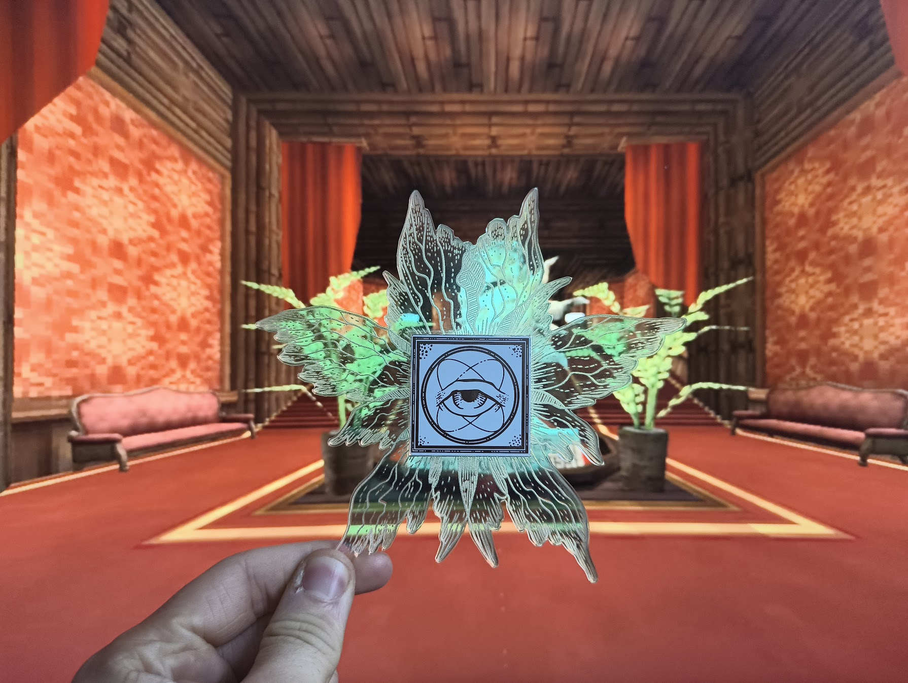

# Providencebadge

## License

This repository contains three separately licensed things:

### Hardware — CERN-OHL-P v2

Copyright © 2026 CritBit.

The electronic design (schematics, PCB layout, routing, and the other design
files in this repository, excluding the artwork and firmware described below) is Open
Hardware, licensed under the CERN Open Hardware Licence Version 2 - Permissive.
You may redistribute and modify it under the terms of the
[CERN-OHL-P v2](LICENSES/CERN-OHL-P-2.0.txt) (https://ohwr.org/cern_ohl_p_v2.txt).

It is distributed WITHOUT ANY EXPRESS OR IMPLIED WARRANTY, INCLUDING OF
MERCHANTABILITY, SATISFACTORY QUALITY AND FITNESS FOR A PARTICULAR PURPOSE.
Please see the CERN-OHL-P v2 for applicable conditions.

### Artwork — CC BY-NC-SA 4.0

Copyright © 2026 @weasel.

The character artwork — the drawings in the `.svg` files and the same graphics
where they appear in the PCB files (silkscreen, copper, solder mask and board
outline) — is licensed under
[Creative Commons Attribution-NonCommercial-ShareAlike 4.0 International](LICENSES/CC-BY-NC-SA-4.0.txt)
(https://creativecommons.org/licenses/by-nc-sa/4.0/).

Because the artwork is part of the board layout, a badge manufactured from
these files as-is includes it, so the non-commercial and share-alike conditions
apply to such badges. The CERN-OHL-P terms apply on their own only to the design with the
artwork removed or replaced.

### Firmware — MIT

Copyright © 2026 CritBit.

The firmware in [`fw/`](fw/) is licensed under the [MIT License](LICENSES/MIT.txt).

### Fan work disclaimer

This is an unofficial, non-commercial fan work depicting a character from
*ULTRAKILL*. *ULTRAKILL* and its characters belong to Arsi "Hakita" Patala and
New Blood Interactive. This project is not affiliated with or endorsed by them,
and the licenses above cover only the original contributions of the authors
named here, not the underlying character.
